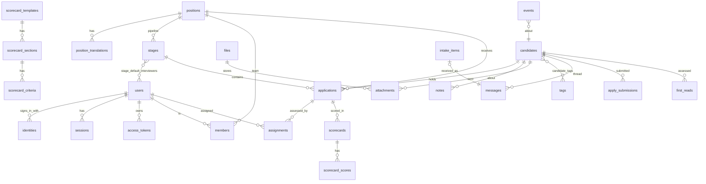

# 04 — Data model

PostgreSQL 16+. The extensions are `citext`, `pg_trgm` and `unaccent`, all three in contrib and so present in the official `postgres` image. Everything below is the **reference schema**: the first Alembic migration must produce exactly this. SQLAlchemy 2 models mirror it one-to-one, and a CI test compares the models to the database to catch drift (09 §Testing).

Conventions:
- Primary keys are `uuid` generated by the application as **UUIDv7**, so they sort in time order. The exceptions are `events.id` and `llm_calls.id`, which are `bigint identity`.
- All timestamps are `timestamptz`, with a `now()` default in the database **and** set by the application.
- Enums are Postgres `text` columns with a `CHECK (col IN (...))`, never `CREATE TYPE`. Adding a value is then a one-line migration.
- Every foreign key states its `ON DELETE` explicitly.
- Personal data columns are marked 🔒 in the tables below. The erasure routine (05 §GDPR) must reach every one of them.
- Tables are grouped by topic below, not in creation order. The first migration **creates every table without cross-table foreign keys, then adds all of them with `ALTER TABLE … ADD CONSTRAINT`**. Many references point forward (`settings → users`, `positions → scorecard_templates`, `users → files`, `attachments → messages`, and others).
- The SQL here was checked on PostgreSQL 16.15.
- **The tables and `ALTER`s in [13 Agent platform](13-agent-platform.md) §2, §3, §4 and §8 are part of this reference schema**, together with `positions.autopilot` (13 §5). The first migration creates them too.

## 1. Entity overview



## 2. Settings and secrets

```sql
CREATE TABLE settings (               -- one row per key; typed by pydantic models in code (09 §Config)
  key         text PRIMARY KEY,       -- canonical list in 09 §4 (typed keys)
  value       jsonb NOT NULL,
  updated_at  timestamptz NOT NULL DEFAULT now(),
  updated_by  uuid REFERENCES users(id) ON DELETE SET NULL
);

CREATE TABLE secrets (                -- credentials entered in the UI; never returned by any API, only "set / not set" + fingerprint
  name        text PRIMARY KEY,       -- e.g. 'auth.microsoft.client_secret', 'llm.openrouter.key.2', 'mail.smtp.password'
  ciphertext  bytea NOT NULL,         -- AES-256-GCM, key = HKDF(SECRET_KEY, info='ochre-secrets-v1')
  nonce       bytea NOT NULL,
  fingerprint text NOT NULL,          -- first 8 hex chars of sha256(plaintext), for "which key is this?"
  updated_at  timestamptz NOT NULL DEFAULT now(),
  updated_by  uuid REFERENCES users(id) ON DELETE SET NULL
);
```

Precedence: an environment variable overrides the database value. Settings use `OCHRE__<KEY>__<FIELD>` (for example `OCHRE__LLM__ENABLED=false`). Secrets use `OCHRE_SECRET__<NAME>` with dots written as `__` (for example `OCHRE_SECRET__LLM__OPENROUTER__KEY__1`). The UI shows "set by environment" and makes the field read-only.

## 3. Users and access

```sql
CREATE TABLE users (
  id               uuid PRIMARY KEY,
  email            citext NOT NULL UNIQUE,                    -- 🔒
  display_name     text NOT NULL,                             -- 🔒
  given_name       text, family_name text,                    -- 🔒
  avatar_file_id   uuid REFERENCES files(id) ON DELETE SET NULL,
  job_title        text,
  locale           text NOT NULL DEFAULT 'en',
  timezone         text NOT NULL DEFAULT 'UTC',
  role             text NOT NULL DEFAULT 'member' CHECK (role IN ('admin','recruiter','member')),
  role_managed_by  text,                                      -- provider id when the IdP decides the role (03 §2.4), else NULL
  state            text NOT NULL DEFAULT 'active' CHECK (state IN ('invited','active','deactivated')),
  password_hash    text,                                      -- argon2id; NULL unless local
  provisioned_by   text NOT NULL CHECK (provisioned_by IN ('setup','invite','scim','jit')),  -- gates link-by-email (03 §2)
  screening_url    text CHECK (screening_url ~ '^https://[^/\s]+\.[^\s]+$'),  -- Scheduling Links
  interview_url    text CHECK (interview_url ~ '^https://[^/\s]+\.[^\s]+$'),
  notify           jsonb NOT NULL DEFAULT '{"mentions":true,"assignments":true,"daily":false}',
  scim_external_id text UNIQUE,
  last_login_at    timestamptz,
  created_at       timestamptz NOT NULL DEFAULT now(),
  updated_at       timestamptz NOT NULL DEFAULT now(),
  deactivated_at   timestamptz
);

CREATE TABLE identities (            -- links a user to an IdP subject
  provider    text NOT NULL,         -- id from settings.auth.providers[].id, e.g. 'microsoft'
  subject     text NOT NULL,         -- OIDC 'sub'; for the microsoft preset the 'oid' claim (03 §1)
  user_id     uuid NOT NULL REFERENCES users(id) ON DELETE CASCADE,
  email_at_link citext NOT NULL,
  created_at  timestamptz NOT NULL DEFAULT now(),
  last_used_at timestamptz,
  PRIMARY KEY (provider, subject)
);

CREATE TABLE sessions (
  id           uuid NOT NULL UNIQUE,  -- public id for the "your sessions" list and DELETE /api/me/sessions/{id}
  id_hash      bytea PRIMARY KEY,     -- sha256(cookie secret)
  user_id      uuid NOT NULL REFERENCES users(id) ON DELETE CASCADE,
  csrf_token   text NOT NULL,
  created_at   timestamptz NOT NULL DEFAULT now(),
  last_seen_at timestamptz NOT NULL DEFAULT now(),
  expires_at   timestamptz NOT NULL,  -- absolute
  user_agent   text, ip_hash bytea    -- ip_hash: see §13
);
CREATE INDEX ON sessions (user_id);

CREATE TABLE access_tokens (          -- personal access tokens and SCIM tokens
  id          uuid PRIMARY KEY,
  kind        text NOT NULL CHECK (kind IN ('pat','scim')),
  user_id     uuid REFERENCES users(id) ON DELETE CASCADE,   -- NULL for scim
  provider    text,                   -- the sign-in provider a SCIM token provisions for; NULL for pat
  name        text NOT NULL,
  prefix      text NOT NULL,          -- first 8 chars of the random part (after 'ochre_pat_' / 'ochre_scim_'), shown in UI and in 'via'
  token_hash  bytea NOT NULL UNIQUE,
  read_only   boolean NOT NULL DEFAULT false,
  expires_at  timestamptz,
  last_used_at timestamptz,
  created_at  timestamptz NOT NULL DEFAULT now(),
  revoked_at  timestamptz,
  CHECK (kind <> 'pat' OR user_id IS NOT NULL),   -- oauth tokens carry user_id ("as you") or agent_id (13 §3, §6)
  CHECK ((kind = 'scim') = (provider IS NOT NULL))
);

CREATE TABLE user_tokens (            -- one-time links: invitations, password resets, setup
  token_hash  bytea PRIMARY KEY,
  kind        text NOT NULL CHECK (kind IN ('invite','reset','setup')),
  user_id     uuid REFERENCES users(id) ON DELETE CASCADE,
  expires_at  timestamptz NOT NULL,
  used_at     timestamptz,
  created_by  uuid REFERENCES users(id) ON DELETE SET NULL,
  created_at  timestamptz NOT NULL DEFAULT now()
);
```

Global Role changes, deactivations and Job Role grants are **Events** (§9), not separate history tables.

## 4. Positions and pipelines

```sql
CREATE TABLE positions (
  id                 uuid PRIMARY KEY,
  slug               text NOT NULL UNIQUE,   -- 'senior-backend-engineer-3fa2'; careers URL
  title              text NOT NULL CHECK (length(title) BETWEEN 1 AND 200),
  department         text,
  location           text,
  remote_policy      text NOT NULL DEFAULT 'on_site' CHECK (remote_policy IN ('on_site','hybrid','remote')),
  employment_type    text NOT NULL DEFAULT 'full_time'
                     CHECK (employment_type IN ('full_time','part_time','contract','internship','apprenticeship')),
  description_md     text NOT NULL DEFAULT '',
  requirements_md    text NOT NULL DEFAULT '',
  aliases            text[] NOT NULL DEFAULT '{}',    -- other names the position is advertised as; used by job_match only (≤5 × ≤120 chars)
  salary_min         integer CHECK (salary_min >= 0),        -- whole currency units
  salary_max         integer,
  salary_currency    char(3),                                -- ISO 4217
  salary_period      text CHECK (salary_period IN ('year','month','day','hour')),
  salary_public      boolean NOT NULL DEFAULT false,
  status             text NOT NULL DEFAULT 'draft' CHECK (status IN ('draft','open','paused','closed')),
  automation_enabled boolean NOT NULL DEFAULT false,
  default_screener_id uuid REFERENCES users(id) ON DELETE SET NULL,   -- must be Screener-eligible (03 §4)
  scorecard_template_id uuid REFERENCES scorecard_templates(id) ON DELETE SET NULL,
  created_by_id      uuid REFERENCES users(id) ON DELETE SET NULL,
  published_at       timestamptz,          -- first publication; never overwritten
  closed_at          timestamptz,
  created_at         timestamptz NOT NULL DEFAULT now(),
  updated_at         timestamptz NOT NULL DEFAULT now(),
  CHECK (salary_max IS NULL OR salary_min IS NULL OR salary_max >= salary_min),
  CHECK ((salary_min IS NULL AND salary_max IS NULL) OR salary_currency IS NOT NULL)
);
CREATE INDEX ON positions (status);

CREATE TABLE position_translations (
  position_id     uuid NOT NULL REFERENCES positions(id) ON DELETE CASCADE,
  locale          text NOT NULL,                        -- BCP 47, must be in settings.careers.locales
  title           text, department text, location text,
  description_md  text, requirements_md text,           -- NULL/blank = fall back to default locale
  PRIMARY KEY (position_id, locale)
);

CREATE TABLE stages (
  id           uuid PRIMARY KEY,
  position_id  uuid NOT NULL REFERENCES positions(id) ON DELETE CASCADE,
  name         text NOT NULL CHECK (length(name) BETWEEN 1 AND 60),
  kind         text NOT NULL CHECK (kind IN ('applied','screening','interview','offer','custom')),
  color        text NOT NULL,                 -- stage palette token name (08), e.g. 'slate', 'cobalt'
  ord          smallint NOT NULL,
  actions      jsonb NOT NULL DEFAULT '[]',   -- see below
  scorecard_template_id uuid REFERENCES scorecard_templates(id) ON DELETE SET NULL,
  UNIQUE (position_id, ord) DEFERRABLE INITIALLY DEFERRED,
  UNIQUE (id, position_id)                    -- target of the composite FK from applications
);
CREATE UNIQUE INDEX one_applied_stage ON stages (position_id) WHERE kind = 'applied';
CREATE UNIQUE INDEX one_offer_stage   ON stages (position_id) WHERE kind = 'offer';

CREATE TABLE stage_default_interviewers (
  stage_id uuid NOT NULL REFERENCES stages(id) ON DELETE CASCADE,
  user_id  uuid NOT NULL REFERENCES users(id) ON DELETE CASCADE,
  PRIMARY KEY (stage_id, user_id)
);

CREATE TABLE members (                -- Job Members
  position_id  uuid NOT NULL REFERENCES positions(id) ON DELETE CASCADE,
  user_id      uuid NOT NULL REFERENCES users(id) ON DELETE CASCADE,
  role         text NOT NULL CHECK (role IN ('owner','hiring_manager','screener','interviewer','viewer')),
  granted_by   uuid REFERENCES users(id) ON DELETE SET NULL,
  created_at   timestamptz NOT NULL DEFAULT now(),
  updated_at   timestamptz NOT NULL DEFAULT now(),
  PRIMARY KEY (position_id, user_id)
);
```

The `stages.actions` schema is validated by a pydantic discriminated union:
```json
[
  {"type": "assign_default_interviewers", "when": "always" | "single_default", "role": "screener" | "interviewer"},
  {"type": "send_template", "template_kind": "screening_invitation" | "interview_invitation" | "custom", "template_id": "uuid|null"}
]
```
`template_id: null` means "the default template of that kind, in the Candidate's locale".

Invariants enforced in code:
- the `applied` Stage has `ord = 0`;
- the `default_screener_id` user is **Screener-eligible**: active, has a `screening_url`, and is a recruiter or admin, or a member of this Position with role `owner`, `hiring_manager` or `screener`;
- the default interviewers of a Stage are active users who can reach the Position.

## 5. Candidates, files, applications

```sql
CREATE TABLE files (
  id           uuid PRIMARY KEY,
  storage_key  text NOT NULL UNIQUE,      -- 'files/2026/11/<uuid>' (same layout for local and S3; no extension)
  filename     text NOT NULL,             -- original name, sanitised (basename, ≤255)
  content_type text NOT NULL,             -- sniffed, not trusted from client
  size_bytes   integer NOT NULL,
  sha256       bytea NOT NULL,
  derived_from_id uuid REFERENCES files(id) ON DELETE CASCADE,   -- e.g. the PDF preview of a DOCX
  derived_kind text CHECK (derived_kind IN ('pdf_preview')),
  created_at   timestamptz NOT NULL DEFAULT now(),
  UNIQUE (derived_from_id, derived_kind)
);

CREATE TABLE candidates (
  id              uuid PRIMARY KEY,
  email           citext UNIQUE,                                    -- 🔒
  linkedin_slug   citext UNIQUE,                                    -- 🔒 'ada-lovelace' from linkedin.com/in/<slug>; URL rebuilt on read
  first_name      text NOT NULL CHECK (length(first_name) BETWEEN 1 AND 100),   -- 🔒
  last_name       text NOT NULL CHECK (length(last_name)  BETWEEN 1 AND 100),   -- 🔒
  phone           text,                                             -- 🔒
  current_company text, current_title text,                         -- 🔒
  location        text,                                             -- 🔒
  locale          text,                     -- language to write to them in; from Apply Form or detected
  source          text NOT NULL CHECK (source IN ('mailbox','careers','manual')),
  cv_file_id      uuid REFERENCES files(id) ON DELETE SET NULL,
  cv_text         text,                     -- 🔒 extracted plain text (search + First Read)
  cv_parsed       jsonb,                    -- 🔒 ParsedCV (05 §4.2), NULL if never parsed
  library_since   timestamptz,              -- in the CV Library when NOT NULL
  last_activity_at timestamptz NOT NULL DEFAULT now(),   -- drives retention (05 §8.1)
  purge_due_at    timestamptz,              -- set by retention when selected; cleared by any activity
  search_doc      text GENERATED ALWAYS AS (
                    public.immutable_unaccent(lower(coalesce(first_name,'')||' '||coalesce(last_name,'')||' '||coalesce(email::text,'')
                    ||' '||coalesce(current_company,'')||' '||coalesce(current_title,'')||' '||coalesce(phone,'')))) STORED,
  created_at      timestamptz NOT NULL DEFAULT now(),
  updated_at      timestamptz NOT NULL DEFAULT now(),
  CHECK (email IS NOT NULL OR linkedin_slug IS NOT NULL)
);
CREATE INDEX candidates_search ON candidates USING gin (search_doc gin_trgm_ops);
CREATE INDEX ON candidates (library_since) WHERE library_since IS NOT NULL;
-- Created in the first migration, schema-qualified so that pg_dump/pg_restore works (an unqualified call fails on restore):
-- CREATE FUNCTION public.immutable_unaccent(text) RETURNS text
--   LANGUAGE sql IMMUTABLE PARALLEL SAFE STRICT
--   AS $$ SELECT public.unaccent('public.unaccent'::regdictionary, $1) $$;

CREATE TABLE attachments (
  id            uuid PRIMARY KEY,
  candidate_id  uuid NOT NULL REFERENCES candidates(id) ON DELETE CASCADE,
  file_id       uuid NOT NULL REFERENCES files(id) ON DELETE CASCADE,
  origin        text NOT NULL CHECK (origin IN ('mailbox','careers','manual','previous_cv')),
  message_id    uuid REFERENCES messages(id) ON DELETE SET NULL,
  created_at    timestamptz NOT NULL DEFAULT now(),
  UNIQUE (candidate_id, file_id)
);

CREATE TABLE tags (
  id     uuid PRIMARY KEY,
  name   citext NOT NULL UNIQUE CHECK (length(name) BETWEEN 1 AND 40),
  color  text NOT NULL            -- tag palette token (08)
);
CREATE TABLE candidate_tags (
  candidate_id uuid NOT NULL REFERENCES candidates(id) ON DELETE CASCADE,
  tag_id       uuid NOT NULL REFERENCES tags(id) ON DELETE CASCADE,
  PRIMARY KEY (candidate_id, tag_id)
);

CREATE TABLE applications (
  id               uuid PRIMARY KEY,
  candidate_id     uuid NOT NULL REFERENCES candidates(id) ON DELETE CASCADE,
  position_id      uuid NOT NULL REFERENCES positions(id) ON DELETE CASCADE,
  stage_id         uuid NOT NULL,                  -- current Stage; with an Outcome, the Stage it left (used by reopen)
  rank             double precision NOT NULL,      -- order within the stage (fractional indexing: insert between neighbours)
  outcome          text CHECK (outcome IN ('hired','rejected','withdrawn')),
  outcome_reason   text CHECK (outcome_reason IN ('not_a_fit','position_filled','no_response','other')),   -- rejection only; a candidate who withdraws gets Outcome 'withdrawn'
  outcome_note     text,
  outcome_at       timestamptz,
  rating           smallint CHECK (rating BETWEEN 1 AND 5),
  source           text NOT NULL CHECK (source IN ('mailbox','careers','manual','library','transfer')),
  cover_letter     text,                           -- 🔒 mail body or Apply Form message
  stage_entered_at timestamptz NOT NULL DEFAULT now(),
  first_response_at timestamptz,                   -- set once by the first human action (05 §Metrics)
  created_at       timestamptz NOT NULL DEFAULT now(),
  updated_at       timestamptz NOT NULL DEFAULT now(),
  FOREIGN KEY (stage_id, position_id) REFERENCES stages(id, position_id) ON DELETE RESTRICT,
  CHECK ((outcome IS NULL) = (outcome_at IS NULL)),
  CHECK (outcome IS NOT DISTINCT FROM 'rejected' OR outcome_reason IS NULL)   -- plain '=' would pass when outcome is NULL
);
CREATE UNIQUE INDEX one_active_application ON applications (candidate_id, position_id) WHERE outcome IS NULL;
CREATE INDEX ON applications (position_id, stage_id, rank) WHERE outcome IS NULL;
CREATE INDEX ON applications (candidate_id);

CREATE TABLE notes (
  id             uuid PRIMARY KEY,
  candidate_id   uuid NOT NULL REFERENCES candidates(id) ON DELETE CASCADE,
  application_id uuid REFERENCES applications(id) ON DELETE SET NULL,
  author_id      uuid REFERENCES users(id) ON DELETE SET NULL,
  body_md        text NOT NULL CHECK (length(body_md) BETWEEN 1 AND 10000),   -- 🔒
  mentions       uuid[] NOT NULL DEFAULT '{}',
  created_at     timestamptz NOT NULL DEFAULT now(),
  edited_at      timestamptz                       -- author may edit or delete for 15 min; admin may delete any time (code)
);
CREATE INDEX ON notes (candidate_id, created_at);
```

Identity rules, applied in one function, `candidates.resolve()`:
- Email is trimmed and lower-cased. It must match `^[^@\s]+@[^@\s]+\.[A-Za-z]{2,}$`.
- **LinkedIn normaliser (the only one; recruiter input, the Apply Form and `cv_parse` all call it).** It accepts `(https?://)?([a-z0-9-]+\.)?linkedin\.com/in/<slug>` followed optionally by `/`, `?…` or `#…`. Inputs containing `\`, `@`, whitespace or control characters are rejected. The slug is percent-decoded and lower-cased; it may contain letters (including accented ones), digits, `-` and `_`. The stored value is the slug, and the API returns `https://www.linkedin.com/in/<slug>`.
- **Matching by LinkedIn only applies to recruiter-typed data.** A CV that arrives by email or through the Apply Form never matches by LinkedIn, so that an uploaded document cannot take over another person's record. **[Proven]**
- **Slug collision on a non-matching path.** When intake or the Apply Form creates a Candidate whose LinkedIn slug already belongs to another Candidate, the new Candidate is created **without** the slug. The code writes `candidate.possible_duplicate {other_candidate_id}` on both records, and the candidate page shows a "Possible duplicate of …" banner to Rc. Merging is v1.x.
- **Conflicting recruiter input.** If the email matches Candidate A and the LinkedIn matches Candidate B, the request returns `409 identity_conflict`. Each candidate is named only if the caller can reach it.
- The Apply Form never modifies an existing Candidate: a returning address gets its CV stored as an attachment. **[Proven]**

## 6. Assessment

```sql
CREATE TABLE assignments (               -- Interviewer Assignments
  id             uuid PRIMARY KEY,
  application_id uuid NOT NULL REFERENCES applications(id) ON DELETE CASCADE,
  user_id        uuid NOT NULL REFERENCES users(id) ON DELETE RESTRICT,
  role           text NOT NULL CHECK (role IN ('screener','interviewer')),
  status         text NOT NULL DEFAULT 'pending' CHECK (status IN ('pending','scheduled','done','cancelled')),
  scheduled_at   timestamptz,
  meeting_url    text CHECK (meeting_url ~ '^https://'),
  external_ref   text,                     -- calendar adapter event id (v1.x)
  invited_at     timestamptz,
  notes          text,
  created_by     uuid REFERENCES users(id) ON DELETE SET NULL,
  created_at     timestamptz NOT NULL DEFAULT now(),
  updated_at     timestamptz NOT NULL DEFAULT now(),
  CHECK (status <> 'scheduled' OR scheduled_at IS NOT NULL)
);
CREATE UNIQUE INDEX one_live_assignment ON assignments (application_id, user_id) WHERE status <> 'cancelled';
CREATE INDEX ON assignments (user_id, status);

CREATE TABLE scorecard_templates (
  id          uuid PRIMARY KEY,
  name        text NOT NULL,
  description text,
  is_default  boolean NOT NULL DEFAULT false,
  locked_at   timestamptz,              -- set when the first scorecard is submitted; structure immutable after
  created_at  timestamptz NOT NULL DEFAULT now(),
  updated_at  timestamptz NOT NULL DEFAULT now()
);
CREATE UNIQUE INDEX one_default_scorecard_template ON scorecard_templates ((true)) WHERE is_default;

CREATE TABLE scorecard_sections (
  id          uuid PRIMARY KEY,
  template_id uuid NOT NULL REFERENCES scorecard_templates(id) ON DELETE CASCADE,
  name        text NOT NULL,
  weight      numeric(3,2) NOT NULL DEFAULT 1 CHECK (weight BETWEEN 0.5 AND 3),
  ord         smallint NOT NULL,
  UNIQUE (template_id, ord) DEFERRABLE INITIALLY DEFERRED
);
CREATE TABLE scorecard_criteria (
  id          uuid PRIMARY KEY,
  section_id  uuid NOT NULL REFERENCES scorecard_sections(id) ON DELETE CASCADE,
  name        text NOT NULL,
  guidance    text,
  ord         smallint NOT NULL,
  UNIQUE (section_id, ord) DEFERRABLE INITIALLY DEFERRED
);

CREATE TABLE scorecards (
  id              uuid PRIMARY KEY,
  application_id  uuid NOT NULL REFERENCES applications(id) ON DELETE CASCADE,
  evaluator_id    uuid NOT NULL REFERENCES users(id) ON DELETE RESTRICT,
  template_id     uuid NOT NULL REFERENCES scorecard_templates(id) ON DELETE RESTRICT,
  assignment_id   uuid REFERENCES assignments(id) ON DELETE SET NULL,
  recommendation  text CHECK (recommendation IN ('strong_yes','yes','maybe','no','strong_no')),
  comments        text,
  overall         numeric(3,2),           -- weighted mean, computed on submit (below)
  submitted_at    timestamptz,            -- NULL = draft
  created_at      timestamptz NOT NULL DEFAULT now(),
  updated_at      timestamptz NOT NULL DEFAULT now(),
  UNIQUE (application_id, evaluator_id),
  CHECK (submitted_at IS NULL OR (recommendation IS NOT NULL AND overall IS NOT NULL))
);
CREATE TABLE scorecard_scores (
  scorecard_id uuid NOT NULL REFERENCES scorecards(id) ON DELETE CASCADE,
  criterion_id uuid NOT NULL REFERENCES scorecard_criteria(id) ON DELETE RESTRICT,
  score        smallint NOT NULL CHECK (score BETWEEN 1 AND 5),
  comment      text,
  PRIMARY KEY (scorecard_id, criterion_id)
);
```

Scoring rules (code):
- **Submit** requires a score for every Criterion of the template, and a Recommendation. It also requires the assignment, if one is given, to belong to the same Application and the same evaluator.
- `overall = Σ_sections(weight_s × mean(scores_s)) / Σ weight_s`, rounded to 2 decimals. **[New: v0 ignored weights]**
- Submitting the first Scorecard of a template sets `scorecard_templates.locked_at`.
- After submission, only the evaluator may edit, and only for 24 hours. Every change writes an Event. Admins may delete.
- The **Application summary** is computed over submitted Scorecards. It holds, per section, the mean of section means; per criterion (by id), the mean; the overall mean of `overall`; and a count per Recommendation.

## 7. Email

```sql
CREATE TABLE email_templates (
  id          uuid PRIMARY KEY,
  name        text NOT NULL,
  kind        text NOT NULL CHECK (kind IN ('screening_invitation','interview_invitation','interview_reminder','rejection',
                                            'application_received','question_request','offer','custom')),
  locale      text NOT NULL,
  subject     text NOT NULL CHECK (length(subject) <= 300),
  body_md     text NOT NULL,              -- sandboxed Jinja + Markdown (05 §6.2)
  is_default  boolean NOT NULL DEFAULT false,
  created_at  timestamptz NOT NULL DEFAULT now(),
  updated_at  timestamptz NOT NULL DEFAULT now()
);
CREATE UNIQUE INDEX one_default_template ON email_templates (kind, locale) WHERE is_default;

CREATE TABLE messages (                   -- every email in or out about a candidate; also the outbox
  id                  uuid PRIMARY KEY,
  direction           text NOT NULL CHECK (direction IN ('in','out')),
  status              text NOT NULL CHECK (status IN ('received','queued','sending','sent','failed','cancelled')),
  candidate_id        uuid REFERENCES candidates(id) ON DELETE CASCADE,
  application_id      uuid REFERENCES applications(id) ON DELETE SET NULL,
  template_id         uuid REFERENCES email_templates(id) ON DELETE SET NULL,
  template_kind       text,                 -- copied at send time; dedup survives template deletion
  transport           text NOT NULL,        -- 'graph','gmail','smtp','imap','log'
  mailbox             citext NOT NULL,      -- the Ochre-side address (sender for out, intake box for in)
  provider_message_id text,                 -- Graph id / Gmail id / IMAP UID@UIDVALIDITY
  rfc_message_id      text,                 -- Message-ID header (threading)
  in_reply_to         text,
  thread_key          text,                 -- Graph conversationId / Gmail threadId / root Message-ID
  from_addr           citext NOT NULL,      -- 🔒
  to_addrs            citext[] NOT NULL,    -- 🔒
  subject             text NOT NULL,        -- 🔒
  body_text           text NOT NULL,        -- 🔒
  body_html           text,                 -- 🔒
  send_after          timestamptz,          -- delayed sends (rejection "tomorrow 9:00")
  attempts            smallint NOT NULL DEFAULT 0,
  error               text,
  sent_by_id          uuid REFERENCES users(id) ON DELETE SET NULL,  -- NULL = system (stage action, receipt)
  created_at          timestamptz NOT NULL DEFAULT now(),
  sent_at             timestamptz,          -- or received_at for direction='in'
  UNIQUE (transport, mailbox, provider_message_id)
);
CREATE INDEX ON messages (candidate_id, created_at);
CREATE INDEX outbox ON messages (send_after NULLS FIRST, created_at) WHERE status = 'queued';
CREATE INDEX ON messages (application_id, template_kind) WHERE status = 'sent';
```

"Already sent" for bulk previews means that a `messages` row exists with `status='sent'`, the same `application_id` and the same `template_kind`.

## 8. Intake and public submissions

```sql
CREATE TABLE intake_items (
  id             uuid PRIMARY KEY,
  message_id     uuid NOT NULL UNIQUE REFERENCES messages(id) ON DELETE CASCADE,  -- the stored inbound message
  status         text NOT NULL CHECK (status IN ('pending','imported','needs_triage','ignored','dismissed')),
  reason         text CHECK (reason IN ('no_attachment','unsupported_attachment','no_text','not_a_cv','parse_failed',
                                        'ambiguous_match','llm_error','import_error','reply_without_cv',
                                        'self_sent','auto_reply')),   -- NULL when imported
  cv_file_id     uuid REFERENCES files(id) ON DELETE SET NULL,   -- chosen CV, kept so a human can assign it later
  parsed         jsonb,                                         -- 🔒 ParsedCV of that file, if it got that far
  detail         text,                       -- human-readable, never contains CV text
  matched_position_id uuid REFERENCES positions(id) ON DELETE SET NULL,
  candidate_id   uuid REFERENCES candidates(id) ON DELETE CASCADE,       -- set when imported; erasure removes the item
  application_id uuid REFERENCES applications(id) ON DELETE SET NULL,  -- NULL on an imported item = spontaneous (CV Library)
  attempts       smallint NOT NULL DEFAULT 0,
  next_attempt_at timestamptz,               -- automatic retry schedule (05 §4.1)
  resolved_by    uuid REFERENCES users(id) ON DELETE SET NULL,
  created_at     timestamptz NOT NULL DEFAULT now(),
  updated_at     timestamptz NOT NULL DEFAULT now()
);
CREATE INDEX ON intake_items (status, next_attempt_at);

CREATE TABLE apply_submissions (
  id               uuid PRIMARY KEY,
  received_at      timestamptz NOT NULL DEFAULT now(),
  candidate_id     uuid NOT NULL REFERENCES candidates(id) ON DELETE CASCADE,
  position_id      uuid REFERENCES positions(id) ON DELETE SET NULL,
  spontaneous      boolean NOT NULL,          -- snapshot: survives position deletion [New]
  position_title   text,                      -- snapshot for the receipt / digest
  application_id   uuid REFERENCES applications(id) ON DELETE SET NULL,
  email            citext NOT NULL,           -- 🔒 as typed
  first_name text NOT NULL, last_name text NOT NULL, phone text, linkedin_slug citext,   -- 🔒 as typed
  message          text,                      -- 🔒
  cv_file_id       uuid NOT NULL REFERENCES files(id) ON DELETE RESTRICT,
  locale           text NOT NULL,
  consent_version  text NOT NULL,
  consent_at       timestamptz NOT NULL,
  created_candidate boolean NOT NULL,
  ip_hash          bytea NOT NULL,            -- see §13; never the raw IP
  enrich_status    text NOT NULL DEFAULT 'pending' CHECK (enrich_status IN ('pending','done','skipped','failed')),
  enrich_attempts  smallint NOT NULL DEFAULT 0,
  receipt_status   text NOT NULL DEFAULT 'pending' CHECK (receipt_status IN ('pending','queued','throttled')),
  CHECK (NOT spontaneous OR position_id IS NULL)   -- spontaneous ⇒ no position. At insert, code also requires NOT spontaneous ⇒ position_id IS NOT NULL;
                                                   -- the column may become NULL later if the position is deleted
);
CREATE INDEX ON apply_submissions (email, received_at);
CREATE INDEX ON apply_submissions (ip_hash, received_at);
```

## 9. Events (the single audit and timeline log)

```sql
CREATE TABLE events (
  id             bigint GENERATED ALWAYS AS IDENTITY PRIMARY KEY,
  occurred_at    timestamptz NOT NULL DEFAULT now(),
  type           text NOT NULL,              -- catalogue below; CHECK generated from the catalogue
  actor_kind     text NOT NULL CHECK (actor_kind IN ('user','system','applicant','ai')),
  actor_id       uuid REFERENCES users(id) ON DELETE SET NULL,
  via            text,                       -- 'ui' | 'pat:<prefix>' | 'mcp:<prefix>' | 'scim' | 'cli' | 'work:<schedule>'
  position_id    uuid REFERENCES positions(id) ON DELETE SET NULL,   -- position history outlives the position (data keeps a title snapshot)
  candidate_id   uuid REFERENCES candidates(id) ON DELETE CASCADE,
  application_id uuid REFERENCES applications(id) ON DELETE CASCADE,
  subject_user_id uuid REFERENCES users(id) ON DELETE SET NULL,
  data           jsonb NOT NULL DEFAULT '{}' -- ids + small display snapshot; never CV text, never message bodies
);
CREATE INDEX ON events (application_id, occurred_at DESC);
CREATE INDEX ON events (candidate_id, occurred_at DESC);
CREATE INDEX ON events (position_id, occurred_at DESC);
CREATE INDEX ON events (occurred_at DESC);
```

Event catalogue. Every mutation in the service layer writes its Event **in the same transaction**. A test asserts that each service method emits the declared type.

| Type | Subject | `data` |
|---|---|---|
| `application.created` | app | `{source, stage_id, stage_name}` |
| `application.moved` | app | `{from_stage_id, from_stage_name, to_stage_id, to_stage_name}` |
| `application.outcome_set` | app | `{outcome, reason?, note?}` (hire / reject / withdraw) |
| `application.reopened` | app | `{previous_outcome, stage_id}` |
| `application.transferred` | app | `{from_position_id, from_title, to_position_id, to_title}` |
| `application.rated` | app | `{from, to}`. Payload redacted under Blind Scoring |
| `assignment.created` | app | `{assignment_id, user_id, user_name, role, auto: bool}` |
| `assignment.updated` | app | `{assignment_id, changes: {status?, scheduled_at?, meeting_url?}}` |
| `assignment.invited` | app | `{assignment_id, message_id}` |
| `scorecard.submitted` | app | `{scorecard_id, evaluator_id, evaluator_name, overall, recommendation}`. Payload redacted under Blind Scoring |
| `scorecard.edited` / `scorecard.deleted` | app | `{scorecard_id, evaluator_name}` |
| `message.sent` / `message.failed` / `message.received` | cand (+app) | `{message_id, template_kind?, subject}` |
| `note.added` / `note.edited` / `note.deleted` | cand (+app) | `{note_id}` |
| `message.queued` / `message.cancelled` / `message.resent` | cand (+app) | `{message_id, template_kind?}` |
| `attachment.added` / `attachment.removed` | cand | `{attachment_id, filename}` |
| `candidate.possible_duplicate` | cand | `{other_candidate_id}` |
| `candidate.created` | cand | `{source}` |
| `candidate.updated` | cand | `{fields: [names]}`. Field names only, never values |
| `candidate.cv_replaced` / `candidate.cv_removed` | cand | `{file_id?}` |
| `candidate.library_added` / `candidate.library_removed` | cand | `{}` |
| `candidate.tagged` / `candidate.untagged` | cand | `{tag_id, tag_name}` |
| `candidate.erased` | none | `{candidate_ref: sha256(id)}`, kept so the audit shows that an erasure happened |
| `candidate.exported` | cand | `{}` |
| `position.created` / `.updated` / `.published` / `.paused` / `.closed` / `.reopened` / `.deleted` | pos | `{changes?}` |
| `position.pipeline_changed` | pos | `{added?, removed?, reordered?}` |
| `member.granted` / `member.role_changed` / `member.revoked` | pos + subject user | `{role, previous_role?}` |
| `user.invited` / `.activated` / `.role_changed` / `.deactivated` / `.reactivated` | subject user | `{role?, previous_role?, source: 'manual'\|'idp'\|'scim'}` |
| `settings.changed` | none | `{key}` (also covers the Default Pipeline, rubric, careers theme) |
| `tag.created` / `tag.renamed` / `tag.deleted` | none | `{tag_id, name}` |
| `email_template.created` / `.updated` / `.deleted` | none | `{template_id, kind, locale}` |
| `scorecard_template.created` / `.updated` / `.deleted` | none | `{template_id}` |
| `token.created` / `token.revoked` | subject user | `{token_id, kind, prefix}` |
| `user.sessions_revoked` | subject user | `{count, reason: 'logout_all'\|'deactivated'}` |
| `retention.purged` | none | `{count, run_id}` (one per run; each Candidate also gets `candidate.erased`) |
| `secret.changed` | none | `{name, fingerprint}` |
| `proposal.*`, `agent.*`, `webhook.*`, `application.answers_received`, `application.knockout_evaluated` | see 13 §8 | |
| `intake.item_resolved` | cand? | `{intake_item_id, resolution: 'assigned'\|'to_library'\|'dismissed'\|'retried_ok'}` |

`candidates.last_activity_at` is bumped by every Event that carries a `candidate_id`, except `candidate.exported` and `candidate.possible_duplicate`.

**Scope of the "every mutation emits an Event" test**: every public function of every `service.py` that writes to the database must be listed in a decorator `@emits("type", ...)`. The test fails for an unlisted writer, and for a listed one that commits without emitting. Sign-in, session bumps, `llm_calls`, `work_queue` and `work_runs` writes are exempt (they are logs themselves).

## 10. AI and background work

```sql
CREATE TABLE first_reads (
  id            uuid PRIMARY KEY,
  candidate_id  uuid NOT NULL REFERENCES candidates(id) ON DELETE CASCADE,
  week_start    date NOT NULL,              -- Monday, org timezone
  sources       text[] NOT NULL,            -- {'careers','mailbox'}
  verdict       text CHECK (verdict IN ('standout','worth_a_look','pass')),   -- NULL = failed
  bucket        text,                       -- matched position title or family
  confidence    numeric(3,2),
  rationale     text,                       -- 🔒 contains quotes from CV
  location      text,                       -- 🔒
  assessment    jsonb,                      -- 🔒 full validated rubric output
  rubric_version text NOT NULL,             -- sha256 of rubric settings, first 12 hex
  model         text NOT NULL,
  error_kind    text,                       -- exception class only, never message (may quote CV)
  created_at    timestamptz NOT NULL DEFAULT now(),
  UNIQUE (candidate_id, week_start)
);

CREATE TABLE digests (
  week_start      date PRIMARY KEY,
  sent_at         timestamptz,
  recipients      citext[] NOT NULL DEFAULT '{}',
  candidate_count integer NOT NULL DEFAULT 0,
  created_at      timestamptz NOT NULL DEFAULT now()
);

CREATE TABLE llm_calls (                    -- kept 90 days
  id            bigint GENERATED ALWAYS AS IDENTITY PRIMARY KEY,
  created_at    timestamptz NOT NULL DEFAULT now(),
  task          text NOT NULL,              -- an AI Task, or 'test' for `ochre llm test` / Settings → Test
  provider      text NOT NULL,
  model         text NOT NULL,
  key_label     text NOT NULL,              -- e.g. 'openrouter#2'; never the key
  outcome       text NOT NULL CHECK (outcome IN ('ok','retry','rate_limited','error','timeout','budget_blocked','invalid_output')),
  http_status   smallint,
  latency_ms    integer,
  input_tokens  integer, output_tokens integer,
  cost_usd      numeric(10,6),
  candidate_id  uuid REFERENCES candidates(id) ON DELETE SET NULL
);
CREATE INDEX ON llm_calls (created_at);
CREATE INDEX ON llm_calls (provider, created_at);

CREATE TABLE work_queue (
  id            uuid PRIMARY KEY,
  kind          text NOT NULL,              -- registered handler name, e.g. 'mail.dispatch', 'intake.poll', 'apply.receipt'
  payload       jsonb NOT NULL DEFAULT '{}',
  dedupe_key    text,                       -- at most one queued-or-running item per key (rows are deleted on success, so the key frees up)
  run_at        timestamptz NOT NULL DEFAULT now(),
  attempts      smallint NOT NULL DEFAULT 0,
  max_attempts  smallint NOT NULL DEFAULT 5,
  locked_until  timestamptz,
  locked_by     text,
  last_error    text,
  created_at    timestamptz NOT NULL DEFAULT now()
);
CREATE UNIQUE INDEX ON work_queue (dedupe_key) WHERE dedupe_key IS NOT NULL;
CREATE INDEX ON work_queue (run_at);

CREATE TABLE work_runs (                    -- one row per execution of a Schedule or work item; kept 90 days
  id           bigint GENERATED ALWAYS AS IDENTITY PRIMARY KEY,
  name         text NOT NULL,              -- schedule or kind
  started_at   timestamptz NOT NULL DEFAULT now(),
  finished_at  timestamptz,
  outcome      text CHECK (outcome IN ('ok','failed')),   -- a lock skip writes no run row (05 §1.2)
  counters     jsonb NOT NULL DEFAULT '{}',
  error        text,
  trigger      text NOT NULL               -- 'schedule' | 'manual:<user_id>' | 'enqueued' | 'retry' (a failed attempt run again by backoff)
);
CREATE INDEX ON work_runs (name, started_at DESC);
```

## 11. Deletion semantics

| Deleting… | Allowed when | Cascades / effects |
|---|---|---|
| Candidate (erasure, admin) | always | The ordered routine of 05 §8.3. Every row with this `candidate_id` (applications, notes, attachments, tags, assignments, scorecards, **all** messages including user notifications about them, intake items, apply_submissions, first_reads, events) is removed. `work_queue` items whose `payload.candidate_id` matches are deleted. One `candidate.erased` Event (hash only) is written. After commit, `files.gc` deletes unreferenced files. |
| Position (admin) | it has **no Applications at all**; otherwise close it | Stages, members and translations go with it. Its Events stay, with `position_id` set to NULL and the title in `data` |
| Stage | it has no Applications (active or with an Outcome); otherwise move them first | Default interviewers go with it |
| User | never (deactivate instead). SCIM `DELETE` deactivates | n/a |
| Tag | admin | `candidate_tags` rows go with it |
| Email template | admin; refused if a Stage Action names it explicitly | `messages.template_id` is set to NULL; `template_kind` stays |
| Scorecard template | admin; refused while locked | n/a |

Files are never deleted inline. A file is collected when nothing references it: no `candidates.cv_file_id`, `attachments.file_id`, `apply_submissions.cv_file_id`, `intake_items.cv_file_id`, `uploads.file_id` or `users.avatar_file_id`, and no `files.derived_from_id` pointing to a referenced file (`files.gc`, daily).

## 12. Small state tables

```sql
CREATE TABLE uploads (                 -- POST /api/uploads/cv results, before they are attached to a candidate
  id          uuid PRIMARY KEY,
  file_id     uuid NOT NULL REFERENCES files(id) ON DELETE CASCADE,
  parsed      jsonb,                   -- 🔒 ParsedCV or NULL
  parse_status text NOT NULL CHECK (parse_status IN ('ok','fallback','failed')),
  created_by  uuid NOT NULL REFERENCES users(id) ON DELETE CASCADE,
  expires_at  timestamptz NOT NULL,    -- now() + 24 h; deleted by housekeeping
  created_at  timestamptz NOT NULL DEFAULT now()
);

CREATE TABLE rate_limits (             -- fixed-window counters; one row per (bucket, window)
  bucket       text NOT NULL,          -- e.g. 'login:acct:<user_id>', 'login:ip:<ip_hash hex>', 'apply:ip:<hex>', 'apply:global', 'api:<session|pat id>', 'test_invite:<user_id>'
  window_start timestamptz NOT NULL,
  count        integer NOT NULL DEFAULT 0,
  PRIMARY KEY (bucket, window_start)
);                                     -- incremented with INSERT … ON CONFLICT DO UPDATE … RETURNING count; rows older than 2 days pruned by housekeeping

CREATE TABLE idempotency_keys (
  key          text NOT NULL,
  user_id      uuid NOT NULL REFERENCES users(id) ON DELETE CASCADE,
  request_hash bytea NOT NULL,          -- sha256(method, path, body); a reused key with a different body → 422 idempotency_mismatch
  status_code  smallint NOT NULL,
  response     jsonb NOT NULL,
  created_at   timestamptz NOT NULL DEFAULT now(),   -- kept 24 h
  PRIMARY KEY (user_id, key)
);
```

## 13. IP hashing
`ip_hash = HMAC-SHA256(key = HKDF(SECRET_KEY, info='ochre-ip-' || UTC date), msg = ip)`. The salt is derived per day, so nothing extra is stored. Hashes from different days cannot be linked, which is enough for windows of 24 hours or less.

## 14. Seed data (first migration + `ochre seed`)

- **Default Pipeline** (`settings.default_pipeline`): see 02 §W2.
- **One Scorecard Template, "General interview"**, set as default. Section weights are 1.
  - **Experience and skills**: Relevant experience; Technical depth; Problem solving.
  - **Ways of working**: Communication; Collaboration; Ownership.
  - **Motivation and fit**: Interest in the role; Alignment with how we work; Growth potential.
- **Email templates** in `en` and `fr`, one default per kind. Their text is in 05 §6.3.
- **Tag palette**, no tags. (Ochre has no system tags.)
- A `demo` command (`ochre seed --demo`) creates 3 positions and 40 fictional candidates with generated PDF CVs, for screenshots and manual QA. It is never run automatically.
