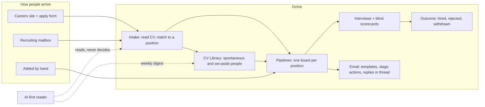
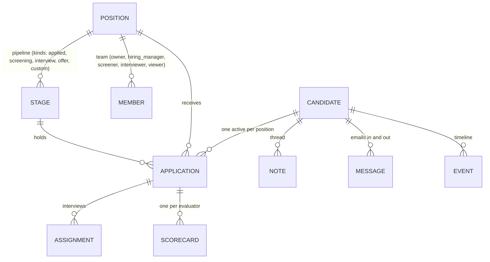
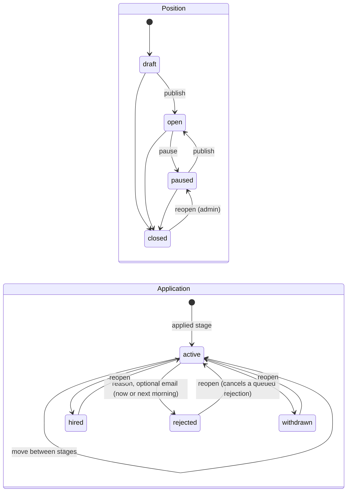
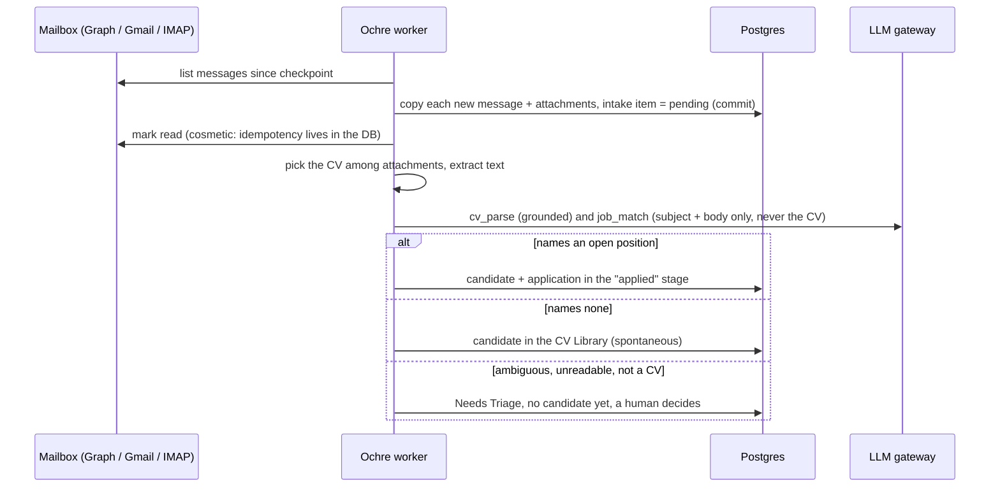
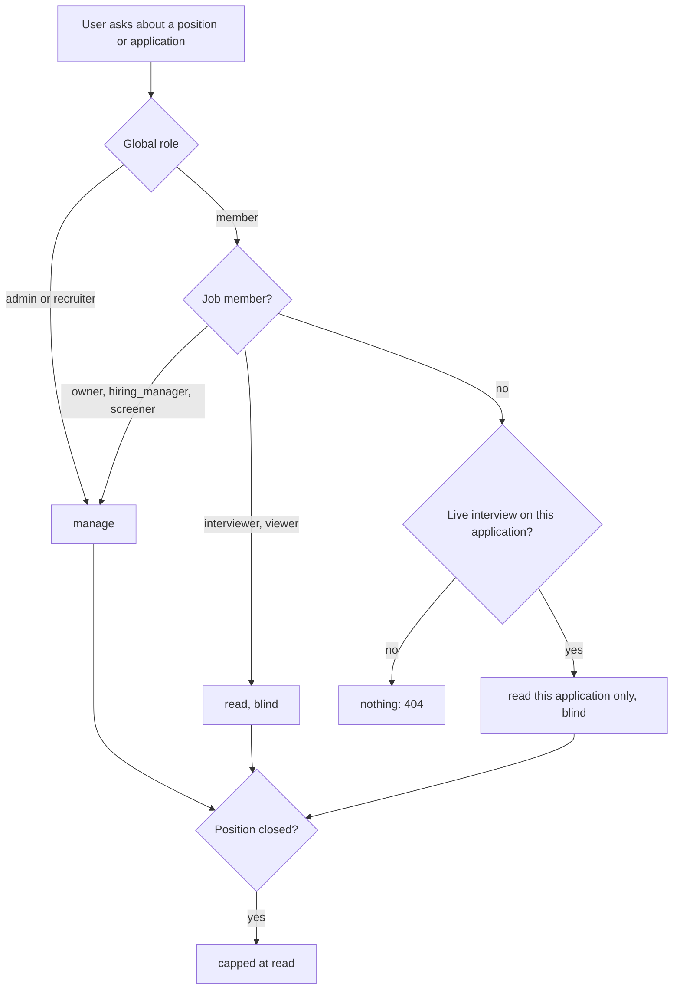

# Ochre in one read

This page explains the whole design in about ten minutes. Every section ends with a link to the detailed spec.

## The problem

A small company hires a few people a year. Applications arrive by email and from a careers page. They get forwarded, lost in inboxes, and discussed in chat threads. Interviewers anchor on each other's opinions. Six months later nobody remembers why someone was turned down, and the privacy notice promised a deletion that never happens.

Commercial ATSs solve this at a price, and they keep the data. Ochre is the open-source alternative that a small team can run itself.

## What it does

## Six ideas carry the design

1. **One box.** One container next to Postgres is a complete install. Postgres is also the job queue, the scheduler lock, the search index and the rate limiter. Every outside service (sign-in provider, mail, model, captcha, S3) is an adapter with an "off" state. → [09 Architecture](09-architecture.md)
2. **Your workspace, not ours.** Each concern has three adapters: Microsoft, Google, and a standard protocol (OIDC for sign-in, IMAP/SMTP for mail, a plain link for booking). Local accounts make Ochre work with nothing configured. These combine into four setup profiles: `microsoft`, `google`, `standard` and `solo`. → [03 Identity and access](03-identity-access.md)
3. **The human decides; the model reads.** The AI parses CVs, matches emails to positions and sorts spontaneous applications. Every fact it returns must be found verbatim in the source, or it is discarded. Verdicts are computed by code from rubric scores. No AI action rejects, hires or emails anyone. → [05 Automation](05-automation.md)
4. **Blind before biased.** Interviewers see no peer score, recommendation or rating until they submit a complete scorecard of their own. The rule is enforced in the server's serializers, so no screen, timeline, stat or search can leak it. → [03 §4](03-identity-access.md)
5. **Everything leaves a trace.** Every change writes one Event in the same transaction. The candidate timeline, the dashboard and the audit log all read the same table. → [04 §9](04-data-model.md)
6. **Candidates are people.** Consent is versioned. Retention runs as a job, not as a promise. Erasure removes every copy, including emails and logs. → [05 §8](05-automation.md)

## The core model

- A **Candidate** exists on their own, identified by email or LinkedIn profile. An **Application** is that person in one position's pipeline.
- **Stages** have a *kind*, so behaviour never depends on a stage's name. Entering a stage can trigger **Stage Actions**: assign the default interviewers, or send the template for that stage's kind.
- An Application leaves the board through an **Outcome** (hired, rejected or withdrawn). It is not a stage, so status and column can never disagree.

The words above have exact meanings. → [01 Glossary](01-glossary.md) · [04 Data model](04-data-model.md)

## Lifecycles

## How an emailed CV becomes a candidate

→ [05 §4 Intake](05-automation.md)

## Who can see what

One function answers every question of this kind, and a test runs every route against eight personas. → [03 §4](03-identity-access.md)

## The AI, concretely

- **Gateway**: any OpenAI-compatible endpoint (OpenRouter, OpenAI, Mistral, Groq, Ollama, vLLM…). A provider can hold several keys, which rotate with cool-down on rate limits. Each task has an ordered fallback route, each provider a daily budget, and every call is logged without its content.
- **Three tasks**:
  - `cv_parse`: structured fields, each checked against the CV text;
  - `job_match`: which open position an email names, if any;
  - `first_read`: a rubric assessment of spontaneous applications, where every "requirement met" needs a verbatim quote and the verdict (standout, worth a look, pass) is computed by code. It feeds a weekly digest to recruiters.
- **Off is a valid setting**: everything still works without a model (regex fallback, keyword matching, no digest).

→ [05 §2–3](05-automation.md)

## Agents: full automation, human decisions

Ochre is built to be driven by agents: your own assistant (Claude, ChatGPT, Copilot) through MCP with OAuth, workflow tools through signed webhooks, or Ochre's built-in morning-triage agent. Every action has a class:
- **Routine** work (notes, tags, template emails, invitations, reminders, moving between stages) can run on its own, under per-position **Autopilot** rules.
- **Consequential** decisions (reject, hire, a free-text email) are filed as **Proposals**, each with grounded evidence. A human approves them in one click, singly or in bulk.
- **Irreversible** acts have no agent tool at all.

Each agent has an owner, scopes, a budget and a kill switch. An AI register and a candidate notice cover the EU AI Act transparency duties. → [13 Agent platform](13-agent-platform.md) · [12 Market gap](12-market-gap.md)

## What it looks like

"Primaries on paper": warm paper and ink, three brand primaries (ultramarine for action, vermilion for attention, cadmium for celebration), and one pigment per stage kind so colour *means* the step. The type pairing is Instrument Sans with Instrument Serif. Gradients appear only on the careers hero, the login page, empty states and the hire moment. → [08 Design system](08-design-system.md) · [07 Screens](07-screens.md)

## Stack in one line

Python 3.13 · FastAPI · SQLAlchemy 2 · Postgres 16+ · pydantic-ai · Vite + React 19 · TanStack Router/Query · Tailwind v4 · shadcn/ui · dnd-kit, plus server-rendered Jinja for the careers site. Everything is MIT-compatible. → [09 Architecture](09-architecture.md)

## Where it came from

The design was extracted from **v0**, a private prototype that ran this recruitment workflow in production for a year. [10 Design history](10-design-history.md) lists what was kept because it worked, what was rebuilt because it didn't, and what was dropped. In the spec, **[Proven]** marks v0 behaviour carried over and **[New]** marks a deliberate change.
